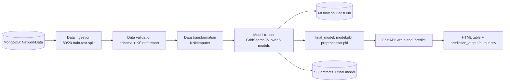

# Network Security: Phishing Website Detection Pipeline

An end-to-end MLOps pipeline that trains a classifier to flag phishing websites from 30 URL and page features, tracks runs in MLflow and serves predictions through a FastAPI app.

## Overview

Phishing sites can often be spotted from structural signals: IP addresses in the URL, URL length, SSL state, domain age, redirects, iframes and similar. This project packages that detection as a pipeline instead of a one-off notebook. Data is pulled from MongoDB, checked against a schema and for drift, imputed, and used to grid-search five scikit-learn classifiers. The chosen model and its preprocessor are saved, metrics are logged to MLflow, artifacts are synced to S3, and a Dockerized FastAPI service exposes `/train` and `/predict`, deployed through GitHub Actions.

## Highlights

- **Four modular stages** (`networkSecurity/components/`): ingestion, validation, transformation and model training. Each is driven by a config class and returns a typed artifact dataclass (`networkSecurity/entity/`).
- **Data validation:** checks column count and numeric columns against `data_schema/schema.yaml` (30 features + `Result` label) and writes a per-column Kolmogorov-Smirnov drift report (p < 0.05 counts as drift) to `Artifacts/<timestamp>/data_validation/drift_report/report.yaml`.
- **Model search:** `GridSearchCV` (3-fold) over Random Forest, Decision Tree, Gradient Boosting, Logistic Regression and AdaBoost. F1, precision and recall for the chosen model are logged to MLflow.
- **Saved model:** `final_model/model.pkl` is a scikit-learn 1.4.2 `RandomForestClassifier`, and `final_model/preprocessor.pkl` is a `KNNImputer` (k = 3) pipeline.
- **CI/CD:** `.github/workflows/main.yml` builds the Docker image, pushes it to Amazon ECR, then pulls and runs it on a self-hosted runner on port 8080.

## Architecture



Intermediate files (splits, drift report, transformed arrays, preprocessor) are written under `Artifacts/<timestamp>/`.

## Tech stack

Python 3.12, scikit-learn, pandas, NumPy, SciPy, MongoDB (pymongo), MLflow + DagsHub, FastAPI + Uvicorn, Docker, GitHub Actions, AWS (ECR, S3).

## Quickstart

```bash
pip install -r requirements.txt
```

Create a `.env` file in the repo root (never commit it):

```
MONGO_DB_URL=MONGODB_URL_REMOVED     # read by data_ingestion.py
MONGODB_URL_KEY=MONGODB_URL_REMOVED  # read by app.py
```

Serve predictions with the committed model (no training needed):

```bash
python app.py   # API docs at http://localhost:8080/docs
```

Upload `valid_data/test.csv` (12 sample rows) to `POST /predict`. The response is an HTML table with a `predicted_column`, and the same table is written to `prediction_output/output.csv`.

Run the full training pipeline:

```bash
python main.py  # runs the four stages; GET /train on the app also syncs results to S3
```

Training needs data that is not in this repo: a MongoDB collection `KEVIN.NetworkData` holding the phishing dataset. It also logs to the DagsHub MLflow server hard-coded in `networkSecurity/components/model_trainer.py` (change the URI or provide DagsHub credentials), and `/train` needs the AWS CLI with access to the S3 bucket named in `networkSecurity/constant/training_pipeline/__init__.py`.

## Project structure

```
networkSecurity/
  components/      data_ingestion, data_validation, data_transformation, model_trainer
  pipeline/        training_pipeline.py (runs all stages, then syncs to S3)
  entity/          config and artifact dataclasses
  constant/        pipeline constants (paths, split ratio, imputer params)
  utils/           YAML and pickle helpers, grid search, metrics, NetworkModel wrapper
  cloud/           S3 sync through the AWS CLI
data_schema/       schema.yaml (column names and types)
final_model/       trained model.pkl and preprocessor.pkl
valid_data/        sample input for /predict
app.py             FastAPI service (/train, /predict)
main.py            runs the pipeline from the command line
Dockerfile, .github/workflows/main.yml
```

## Limitations and next steps

- Candidate models are ranked by `r2_score` on the test split (`networkSecurity/utils/main_utils/utils.py`), which is a regression metric. Ranking by F1 on a separate validation split would be the right criterion.
- No evaluation metrics are saved in the repo. They were logged only to the remote MLflow server.
- The expected-score (0.6) and overfitting (0.85) thresholds are defined in the constants but never enforced, and the CI lint and test steps are placeholders.
- Dependencies are unpinned, but the saved pickles were built with scikit-learn 1.4.2. Next steps: pin versions, add unit tests, and load the data source from a script kept in the repo.

## License

No license specified yet.
